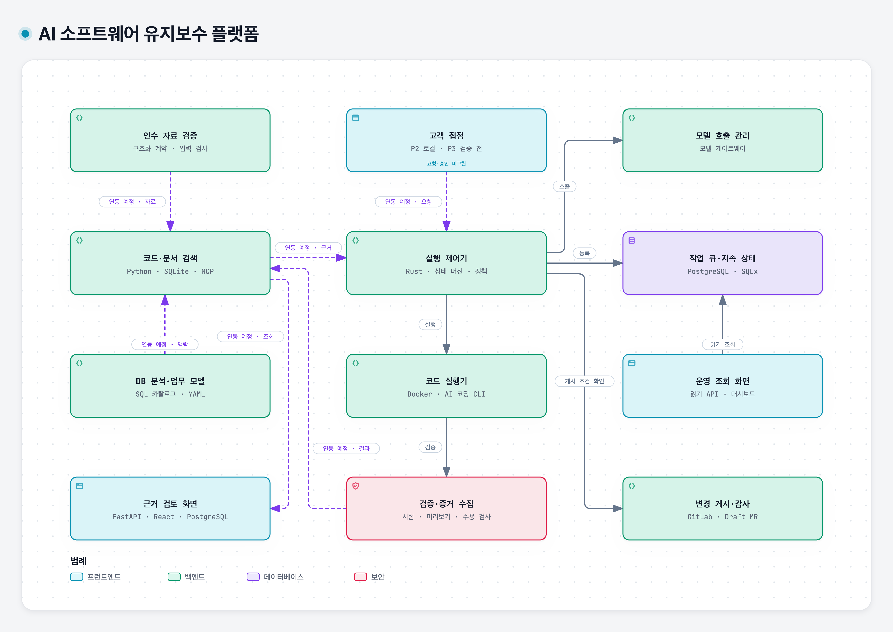
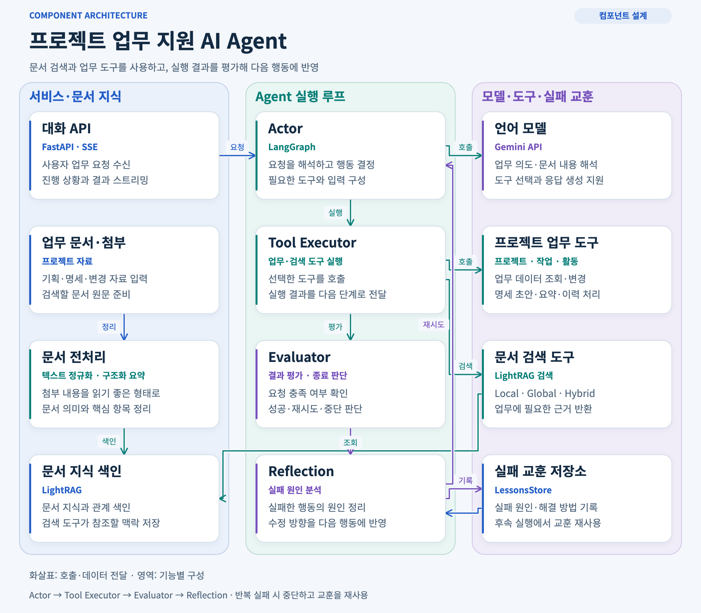
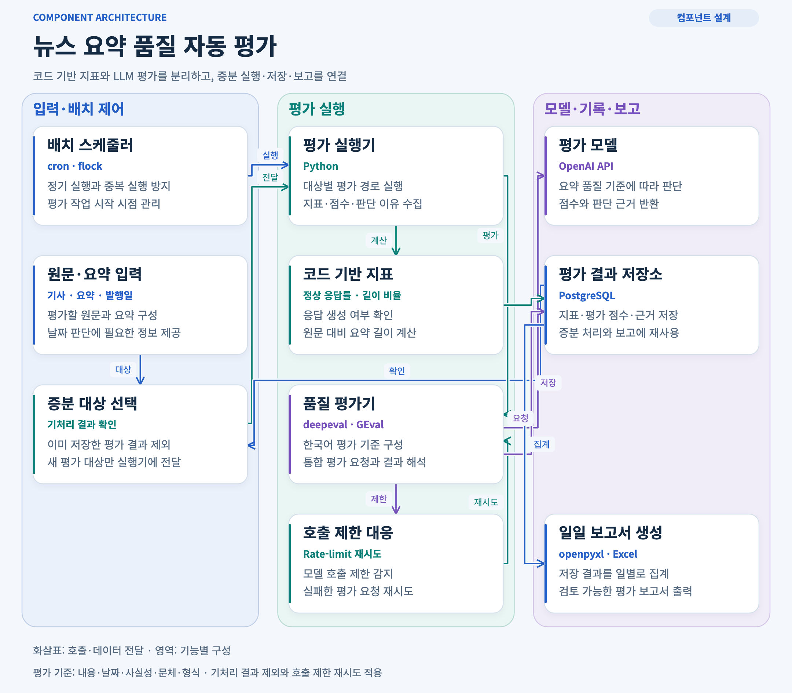
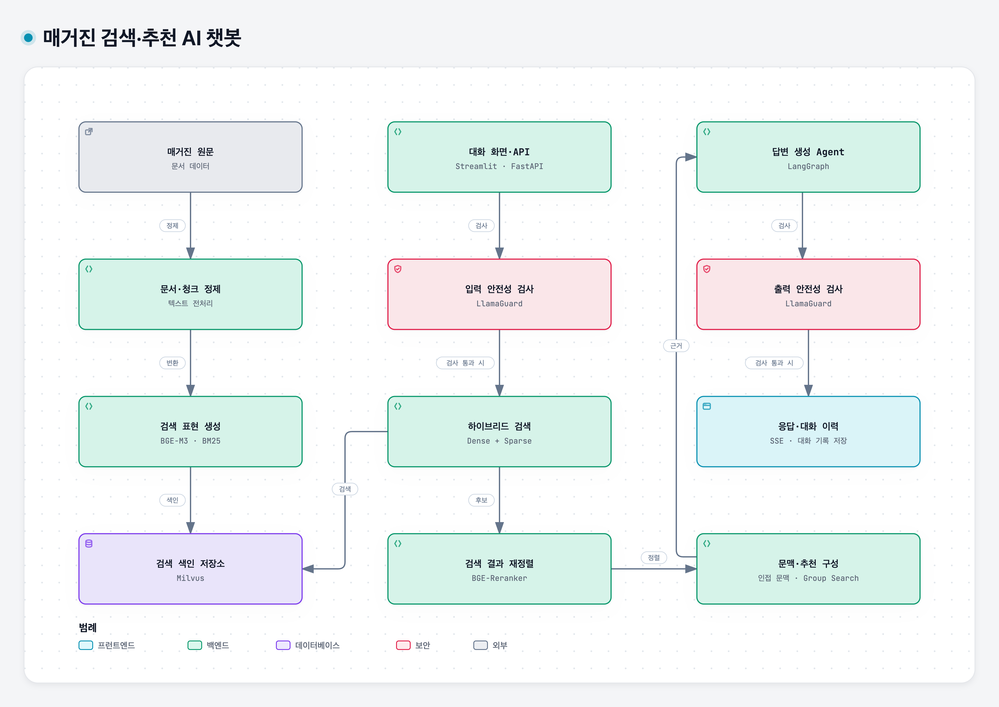
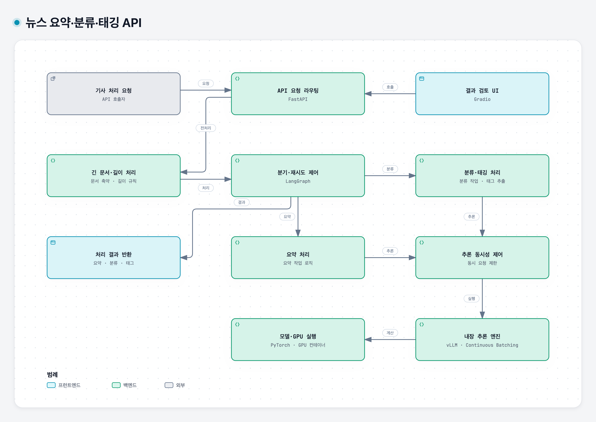
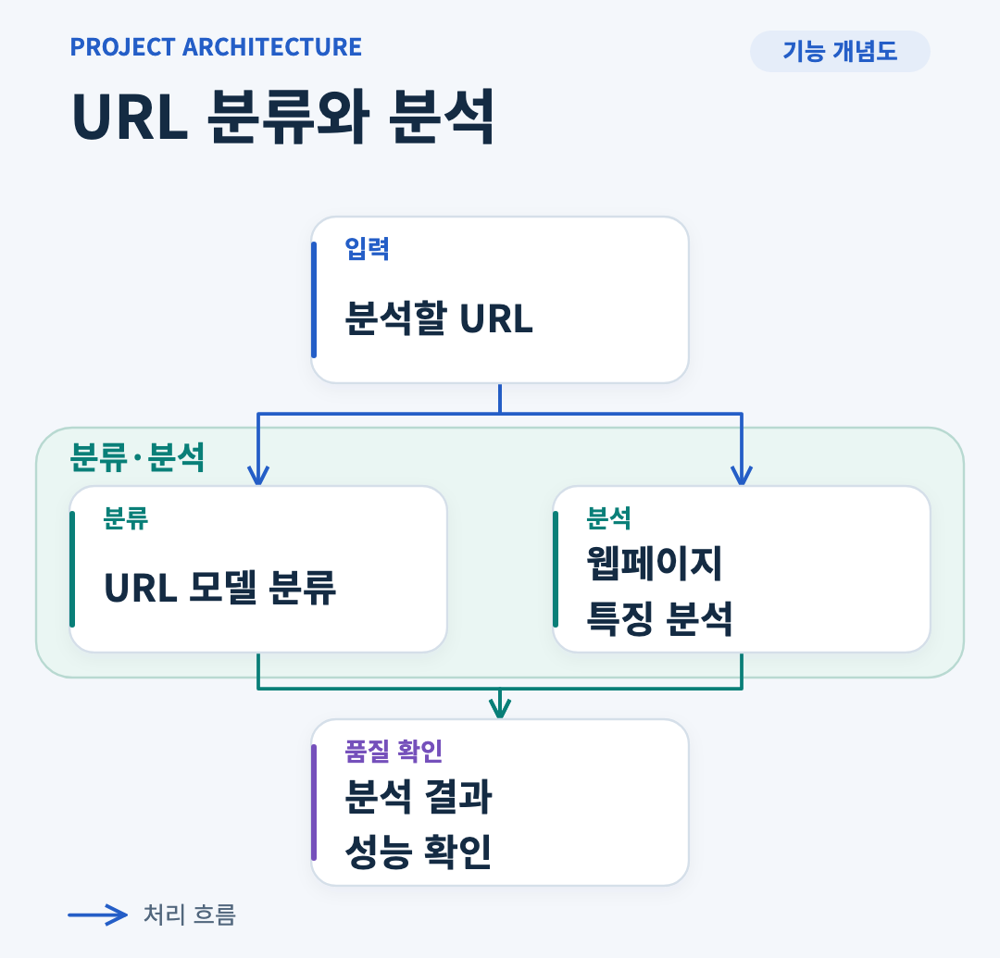
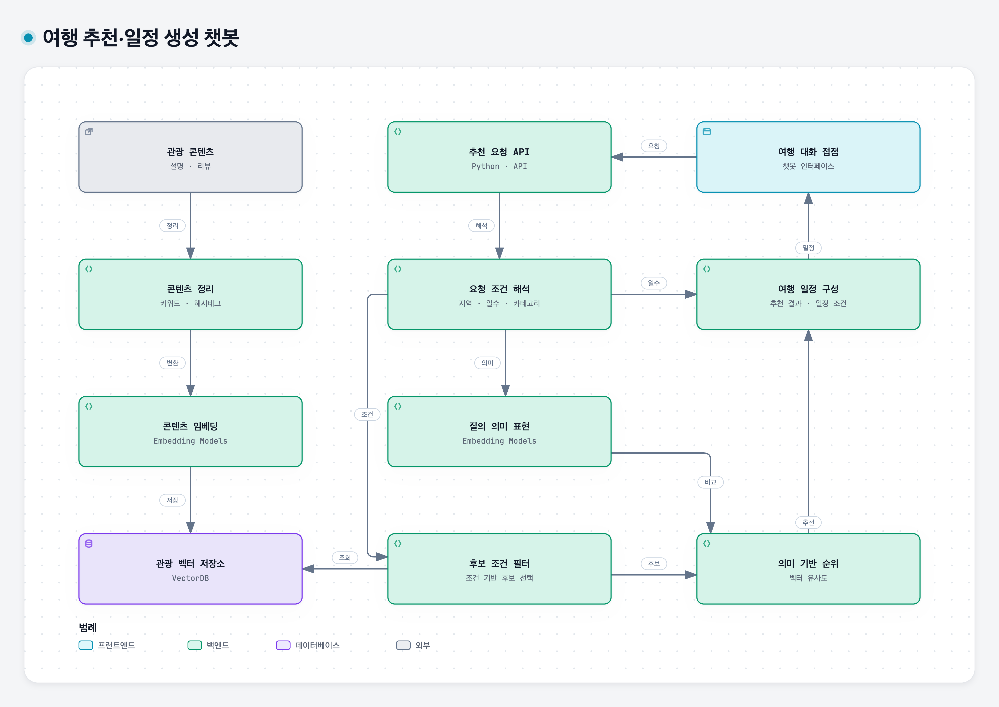
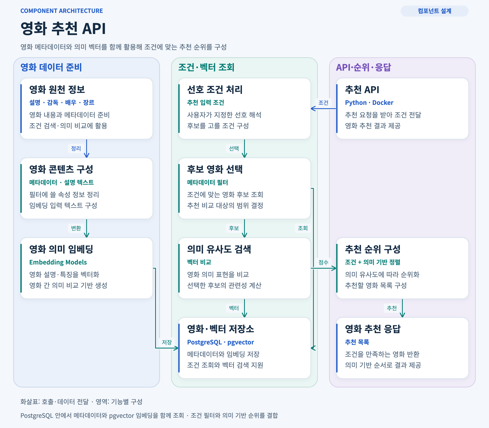
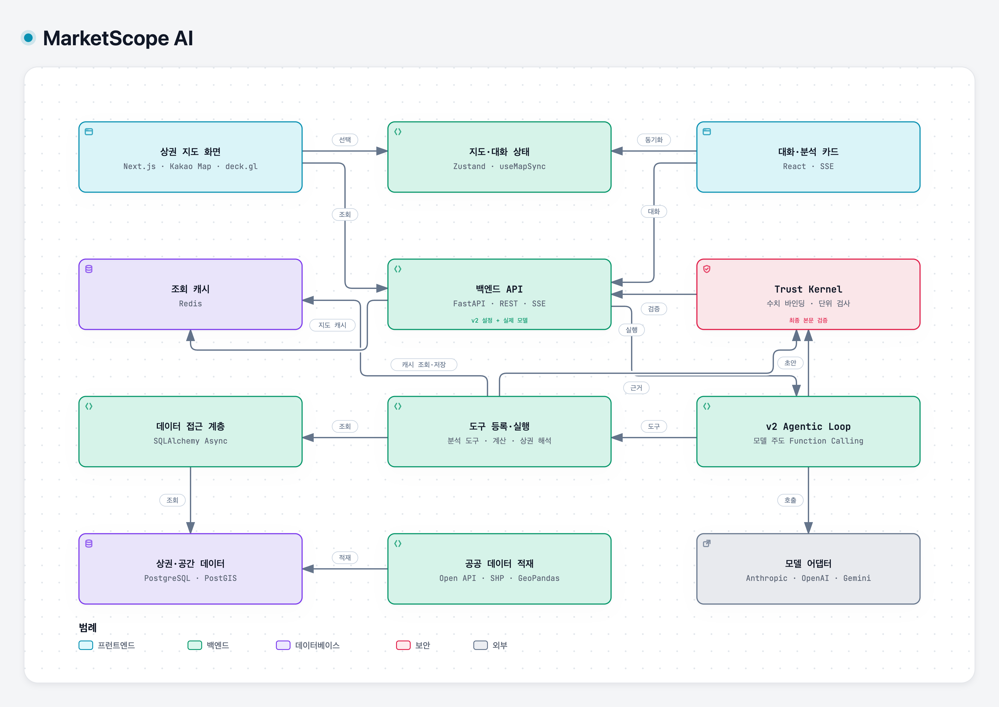

# 김선준 | Sunjun Kim

**AI Agent·LLM 응용 엔지니어**

데이터를 검색하고 도구를 실행하며 결과를 검증하는 AI 서비스를 개발함. 추천 시스템 연구를 시작으로 검색·추천, LLM 응용, 품질 평가와 업무 자동화를 맡아 왔음.

[프로젝트](#프로젝트) · [집필·연구](#집필연구) · [사용 기술](#사용-기술) · [이메일](mailto:cyon13022@gmail.com)

공개 작업: [서비스 코드](https://github.com/SJayKim/Catchment-Area-Analysis) · [공동 집필](https://wikidocs.net/book/19070) · [논문 노트](https://github.com/SJayKim/agentic_ai_papers)

## 프로젝트

| 프로젝트 · 회사 | 주요 기여 |
| --- | --- |
| **[AI 소프트웨어 유지보수 플랫폼](#maintenance-platform)** 위시켓 | AI 코드 수정·검증 흐름, 작업 근거 관리 설계·구현. 개발 중임. |
| **[프로젝트 업무 처리 AI 에이전트](#project-task-agent)** Plantynet | 업무 도구 실행·근거 검색·실패 대응 로직 설계·구현·배포. |
| **[뉴스 요약 품질 자동 평가](#summary-evaluation)** Plantynet | 평가 기준 설계, 자동 평가·결과 저장·정기 보고 구현. |
| **[매거진 검색·추천 AI 챗봇](#magazine-search)** Plantynet | 검색 엔진·데이터 전처리·AI 처리 로직과 응답 안전성 검사 개발. |
| **[뉴스 요약·분류·태깅 API](#news-processing-api)** Plantynet | 자체 모델 처리 로직·서빙 API 설계·개발·배포. |
| **[스미싱 URL 탐지](#smishing-detection)** Plantynet | URL 분류 모델 학습, 웹페이지 특징 분석, 성능 확인 기능 개발. |
| **[여행 추천·일정 생성 챗봇](#travel-recommendation)** AIO2O | AI 파트 리드. 추천 로직·검색용 데이터 저장소·챗봇 개발. |
| **[영화 추천 API](#movie-recommendation)** AIO2O | 추천 로직·데이터 저장소 설계, 조건·의미 기반 추천 API 개발. |
| **[MarketScope AI · 상권 분석](#marketscope-ai)** 개인 프로젝트 | 기획·데이터 처리·서버·화면·AI 기능 1인 개발. |

각 프로젝트의 문제·담당·구현 내용과 설계 선택을 정리함. 도식은 기능별 컴포넌트와 연결 관계를 설명하기 위한 개념도임. [Archify 도식 모음](https://sjaykim.github.io/SJayKim/docs/diagrams/)에서 구성요소·연결·출처를 탐색할 수 있음. 회사 프로젝트는 공개 경력 문서, MarketScope는 공개 코드의 고정된 판을 근거로 작성함.

<strong>AI 소프트웨어 유지보수 플랫폼 · 위시켓</strong>

**문제:** 인수 자료와 코드가 흩어져 있고, AI가 수정한 코드의 근거와 검사 결과를 함께 검토할 필요가 있었음.

**담당:** 시스템 설계, AI 코딩 에이전트를 활용한 구현, 검증 기준·근거 관리를 맡음.

**구현:** 자료 검색·데이터 관계 분석, 코드 수정·검증과 작업 상태 확인 기능을 개발 중임. 구성요소별 검증을 진행하고 있으며 전체 운영 연동 검증은 남아 있음.

**설계 선택:** 실행 제어와 코드 수정·검증을 나누고, 변경 결과에 근거를 붙여 검토할 수 있도록 설계함.

[탐색형 도식](https://sjaykim.github.io/SJayKim/docs/diagrams/maintenance-platform.html) · [PNG 원본](images/architecture/maintenance-platform.png?raw=true) · [SVG 원본](images/architecture/maintenance-platform.svg) · [프로젝트 목록](#프로젝트)

Rust · Python · TypeScript · PostgreSQL · Docker

<strong>프로젝트 업무 처리 AI 에이전트 · Plantynet</strong>

**문제:** 자연어 업무 요청을 실제 도구 실행으로 연결하고 업무 문서에서 필요한 근거를 찾을 수 있어야 했음.

**담당:** AI 처리 로직의 설계·구현·배포를 맡음.

**구현:** 업무 도구와 근거 검색을 연결해 명세 초안·업무 요약·변경 이력 기능을 구현함. 실패 원인 기록, 재시도와 반복 실패 시 중단 처리도 개발함.

**설계 선택:** 도구 실행·결과 평가·실패 회고를 나눠 실패 원인에 따라 다음 행동을 바꾸도록 구성함.

[탐색형 도식](https://sjaykim.github.io/SJayKim/docs/diagrams/project-task-agent.html) · [PNG 원본](images/architecture/project-task-agent.png?raw=true) · [SVG 원본](images/architecture/project-task-agent.svg) · [프로젝트 목록](#프로젝트)

Python · LangGraph · FastAPI · LightRAG · Docker Compose

<strong>뉴스 요약 품질 자동 평가 · Plantynet</strong>

**문제:** 여러 뉴스 요약을 일관된 기준으로 검사하고 결과를 정기적으로 확인할 필요가 있었음.

**담당:** 평가 기준 설계, 자동 처리, 데이터 저장과 정기 실행을 맡음.

**구현:** 원문과 요약을 비교해 품질 점수와 판단 이유를 남기고 보고서로 정리함. 이미 처리한 결과 제외, 실패 작업 재시도와 중복 실행 방지도 구현함.

**설계 선택:** 응답 여부·길이처럼 코드로 계산하는 지표와 내용·사실성 등을 판단하는 LLM 평가를 구분함.

[탐색형 도식](https://sjaykim.github.io/SJayKim/docs/diagrams/summary-evaluation.html) · [PNG 원본](images/architecture/summary-evaluation.png?raw=true) · [SVG 원본](images/architecture/summary-evaluation.svg) · [프로젝트 목록](#프로젝트)

Python · deepeval/GEval · PostgreSQL · openpyxl

<strong>매거진 검색·추천 AI 챗봇 · Plantynet</strong>

**문제:** 키워드 검색만으로는 자연어 독서 의도를 반영하기 어려웠고, 생성 답변의 안전성 확인도 필요했음.

**담당:** 검색 엔진, 데이터 전처리와 AI 처리 로직을 맡음.

**구현:** 의미·키워드 검색과 결과 재정렬, 문맥 보강을 챗봇에 연결함. 검색에 부적합한 데이터를 정리하고 입력·답변의 안전성 검사도 구현함.

**설계 선택:** 의미 검색과 키워드 검색을 함께 사용하고, 재정렬과 주변 문맥 보강으로 답변 근거를 구성함.

[탐색형 도식](https://sjaykim.github.io/SJayKim/docs/diagrams/magazine-search.html) · [PNG 원본](images/architecture/magazine-search.png?raw=true) · [SVG 원본](images/architecture/magazine-search.svg) · [프로젝트 목록](#프로젝트)

Python · Milvus · BGE-M3 · BM25 · BGE-Reranker · LlamaGuard

<strong>뉴스 요약·분류·태깅 API · Plantynet</strong>

**문제:** 외부 API에 의존하던 뉴스 요약·분류·태깅을 자체 모델 서비스로 전환할 필요가 있었음.

**담당:** LLM 처리 로직과 서빙 API의 설계·개발·배포를 맡음.

**구현:** 자체 모델 서빙에 요약 길이 조정, 긴 문서 축약과 실패 시 재시도를 연결함. 요약·분류·태그 추출 API와 검토 화면을 구현하고 API를 배포함.

**설계 선택:** FastAPI 프로세스에 vLLM 엔진을 내장하고, 동시 요청 제한과 Continuous Batching으로 추론 요청을 처리함.

[탐색형 도식](https://sjaykim.github.io/SJayKim/docs/diagrams/news-processing-api.html) · [PNG 원본](images/architecture/news-processing-api.png?raw=true) · [SVG 원본](images/architecture/news-processing-api.svg) · [프로젝트 목록](#프로젝트)

Python · FastAPI · vLLM · LangGraph · Gradio · Docker

<strong>스미싱 URL 탐지 · Plantynet</strong>

**문제:** 문자 사기에 쓰이는 URL을 분류하고, 연결된 웹페이지의 특징과 모델 성능도 확인할 필요가 있었음.

**담당:** URL 분류 모델 학습, 웹페이지 분석과 성능 확인 기능 개발을 맡음.

**구현:** URLBert를 추가 학습하고 URL 텍스트 분류와 웹페이지 특징 분석을 각각 구현함. 평가·보고 기능을 연결해 모델 성능의 추이를 확인하도록 구성함.

**설계 선택:** URL 문자열 분류와 리다이렉트 뒤 페이지 분석을 구분해 URL 자체와 웹페이지 특징을 각각 확인하도록 구성함.

[탐색형 도식](https://sjaykim.github.io/SJayKim/docs/diagrams/smishing-detection.html) · [PNG 원본](images/architecture/smishing-detection.png?raw=true) · [SVG 원본](images/architecture/smishing-detection.svg) · [프로젝트 목록](#프로젝트)

Python · URLBert · Hugging Face Transformers · HTML 분석

<strong>여행 추천·일정 생성 챗봇 · AIO2O</strong>

**문제:** 지역·여행 일수 외에도 동반자·분위기처럼 말로 표현한 여행 의도를 추천에 반영할 필요가 있었음.

**담당:** AI 파트 리드로 추천 로직, 검색용 데이터 저장소와 챗봇 개발을 맡음.

**구현:** 관광지 설명·리뷰에서 후보를 찾고 조건과 의미에 따라 추천 순위를 정함. 추천 결과를 일정으로 연결하고 API와 검색용 데이터 저장소를 배포함.

**설계 선택:** 지역·일수·카테고리 조건과 자연어 선호를 구분하고, 조건으로 후보를 좁힌 뒤 의미 유사도로 추천 순위를 정함.

[탐색형 도식](https://sjaykim.github.io/SJayKim/docs/diagrams/travel-recommendation.html) · [PNG 원본](images/architecture/travel-recommendation.png?raw=true) · [SVG 원본](images/architecture/travel-recommendation.svg) · [프로젝트 목록](#프로젝트)

Python · Embedding Models · Vector DB · Docker Compose

<strong>영화 추천 API · AIO2O</strong>

**문제:** 장르·배우 조건으로만 추천하면 비슷한 결과가 반복돼 영화 설명의 의미도 함께 반영할 필요가 있었음.

**담당:** 추천 로직과 검색용 데이터 저장소 설계를 맡음.

**구현:** 선호 조건으로 후보를 좁힌 뒤 영화 설명의 의미 유사도로 추천 순위를 정함. 조건 필터와 의미 검색을 결합한 기능을 API로 개발함.

**설계 선택:** 장르·배우 등 명시한 조건은 메타데이터로 확인하고, 영화 설명의 의미는 벡터 유사도로 비교함.

[탐색형 도식](https://sjaykim.github.io/SJayKim/docs/diagrams/movie-recommendation.html) · [PNG 원본](images/architecture/movie-recommendation.png?raw=true) · [SVG 원본](images/architecture/movie-recommendation.svg) · [프로젝트 목록](#프로젝트)

Python · PostgreSQL · pgvector · Embedding Models · Docker

<strong>MarketScope AI · 지도 기반 상권 분석 · 개인 프로젝트</strong>

**문제:** 흩어진 상권 통계를 지도와 대화에서 함께 살펴보고 분석할 수 있는 서비스가 필요했음.

**담당:** 기획·데이터 처리·서버·화면·AI 기능을 1인 개발함.

**구현:** 서울시 1,650개 상권 데이터를 조회·비교하는 도구를 지도·대화에 연결함. AI 답변에 포함된 수치를 도구 조회 결과와 대조하는 검증 기능을 구현함.

**설계 선택:** 도구에서 얻은 원본 값을 답변 수치와 대조하고, 근거가 없는 수치는 교정하거나 미확인으로 표시함.

[탐색형 도식](https://sjaykim.github.io/SJayKim/docs/diagrams/marketscope-ai.html) · [PNG 원본](images/architecture/marketscope-ai.png?raw=true) · [SVG 원본](images/architecture/marketscope-ai.svg) · [프로젝트 목록](#프로젝트)

Python · FastAPI · TypeScript · React · PostgreSQL/PostGIS

[코드·프로젝트 설명](https://github.com/SJayKim/Catchment-Area-Analysis) · [실행 안내](https://github.com/SJayKim/Catchment-Area-Analysis/blob/main/docs/ops/quickstart.md) · [수치 검증 코드](https://github.com/SJayKim/Catchment-Area-Analysis/blob/main/server/server/agent/loop/trust.py)

서비스 화면

공개 저장소에 수록된 화면 예시임.

## 집필·연구

**[Just Read. Agentic AI](https://wikidocs.net/book/19070)**

AI가 도구를 사용하고 계획을 세우며 답변을 점검하는 원리를 논문과 함께 설명하는 책을 공동 집필함. ReAct, Reflexion, GraphRAG 등 에이전트의 주요 방법을 다룸.

**[Agentic AI 논문 노트](https://github.com/SJayKim/agentic_ai_papers)**

에이전트의 기억, 도구 사용, 계획, 자기교정, 검색 관련 논문을 주제별로 정리함. 책과 별도로 개별 논문의 핵심 방법을 찾아볼 수 있는 공개 기록임.

UNIST 산업공학과 석사, 2023. 사용자 선호를 학습하는 추천 시스템을 연구함.

## 사용 기술

| 분야 | 기술 |
| --- | --- |
| AI Agent·검색·평가 | LangGraph, LightRAG, vLLM, Milvus, pgvector, deepeval/GEval |
| 서버·데이터 | Python, Rust, FastAPI, PostgreSQL/PostGIS |
| 화면·실행 환경 | TypeScript, React, Docker |
