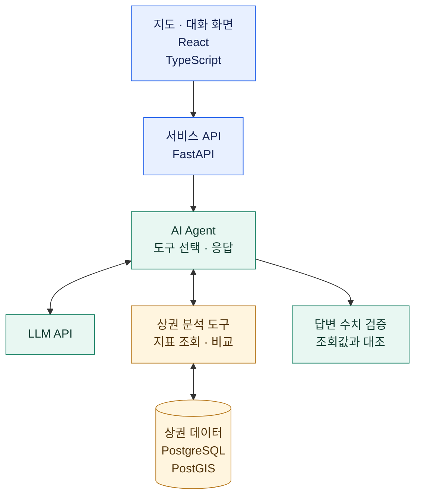
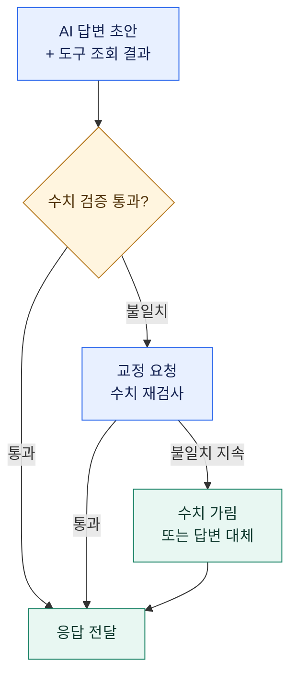

# 김선준 | Sunjun Kim

**AI Agent·LLM 응용 엔지니어**

데이터를 찾고 도구를 실행하는 AI 서비스를 개발함. 추천 시스템 연구를 시작으로 검색·추천, LLM 응용, 품질 평가와 업무 자동화를 맡아 왔음.

[이메일](mailto:cyon13022@gmail.com) · [개인 프로젝트](https://github.com/SJayKim/Catchment-Area-Analysis) · [공동 집필한 책](https://wikidocs.net/book/19070) · [논문 노트](https://github.com/SJayKim/agentic_ai_papers)

## 대표 개인 프로젝트

**MarketScope AI · 지도 기반 상권 분석**

흩어진 상권 통계를 지도와 대화에서 함께 살펴볼 수 있도록 만든 서비스임. 기획·데이터 처리부터 서버·화면·AI 기능까지 1인 개발함.

- 서울시 1,650개 상권 데이터를 연결해 유동인구·매출·업종 정보를 조회하고 상권을 비교하도록 구현함.
- 지도에서 선택한 상권과 대화 내용을 연결하고, AI가 필요한 분석 도구를 호출하도록 개발함.
- AI 답변에 포함된 수치를 도구가 조회한 결과와 대조하는 검증 기능을 구현함.

Python · FastAPI · TypeScript · React · PostgreSQL/PostGIS

공개 저장소에 수록된 화면 예시임.

**시스템 구성**

공개 저장소의 화면·서버·AI 처리 경로를 요약함.

**답변 수치를 확인하는 과정**

설정한 허용 오차 안에서 AI 답변의 수치를 도구 조회값과 대조함. 불일치가 남으면 해당 수치를 가리거나 조회 결과에 근거한 응답으로 대체함. 아래는 수치 검증 경로이며 데이터가 없을 때의 응답 등은 생략함.

[코드·프로젝트 설명](https://github.com/SJayKim/Catchment-Area-Analysis) · [실행 안내](https://github.com/SJayKim/Catchment-Area-Analysis/blob/main/docs/ops/quickstart.md) · [수치 검증 코드](https://github.com/SJayKim/Catchment-Area-Analysis/blob/main/server/server/agent/loop/trust.py)

## 집필·연구

**[Just Read. Agentic AI](https://wikidocs.net/book/19070)**

AI가 도구를 사용하고 계획을 세우며 답변을 점검하는 원리를 논문과 함께 설명하는 책을 공동 집필함. ReAct, Reflexion, GraphRAG 등 에이전트의 주요 방법을 다룸.

**[Agentic AI 논문 노트](https://github.com/SJayKim/agentic_ai_papers)**

에이전트의 기억, 도구 사용, 계획, 자기교정, 검색 관련 논문을 주제별로 정리함. 책과 별도로 개별 논문의 핵심 방법을 찾아볼 수 있는 공개 기록임.

UNIST 산업공학과 석사, 2023. 사용자 선호를 학습하는 추천 시스템을 연구함.

## 회사에서 맡아 온 일

| 회사 | 담당 분야 |
| --- | --- |
| 위시켓 | AI를 활용한 소프트웨어 유지보수 도구 개발 |
| Plantynet | AI 모델 개발, 문서 검색, 뉴스 요약 품질 평가, 업무 자동화 |
| AIO2O | 여행·영화 추천 서비스의 AI 기능 개발 |

## 사용 기술

| 분야 | 기술 |
| --- | --- |
| AI Agent·검색·평가 | LangGraph, LightRAG, vLLM, Milvus, pgvector, deepeval/GEval |
| 서버·데이터 | Python, Rust, FastAPI, PostgreSQL/PostGIS |
| 화면·실행 환경 | TypeScript, React, Docker |
