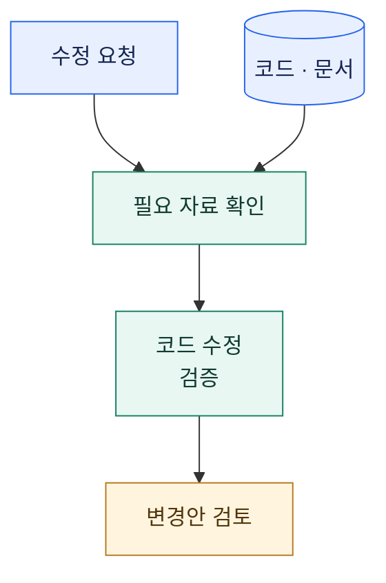
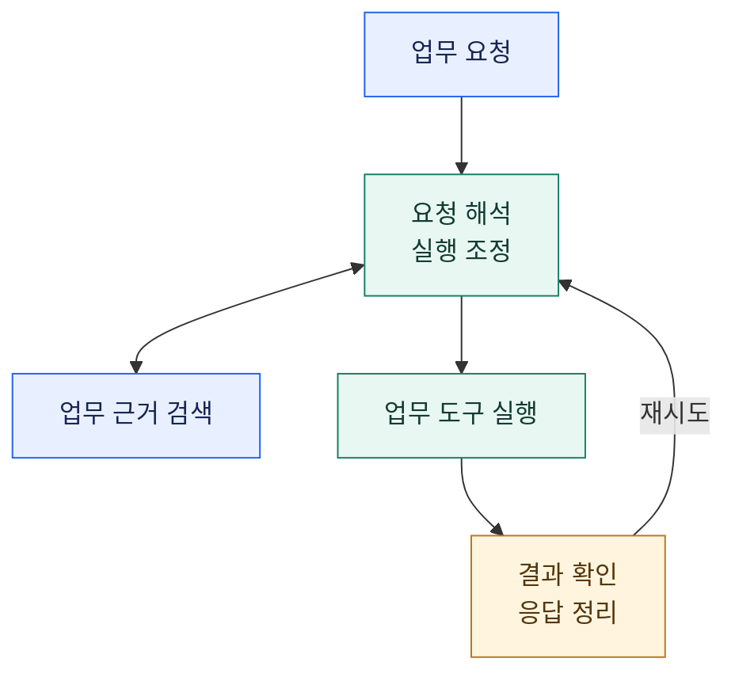
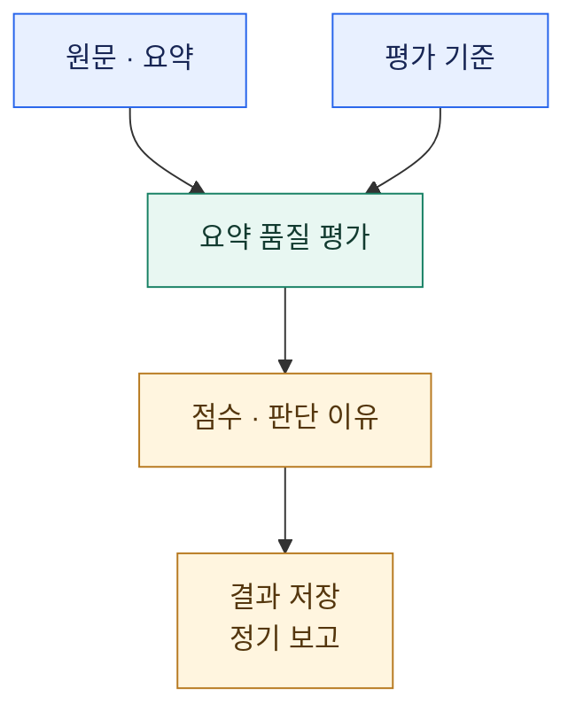
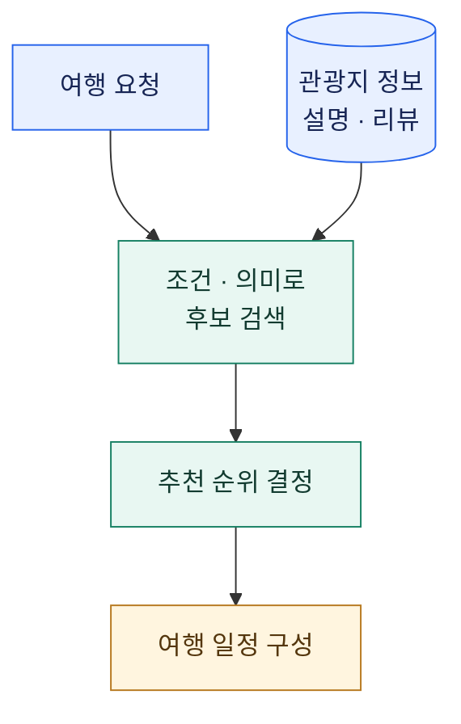
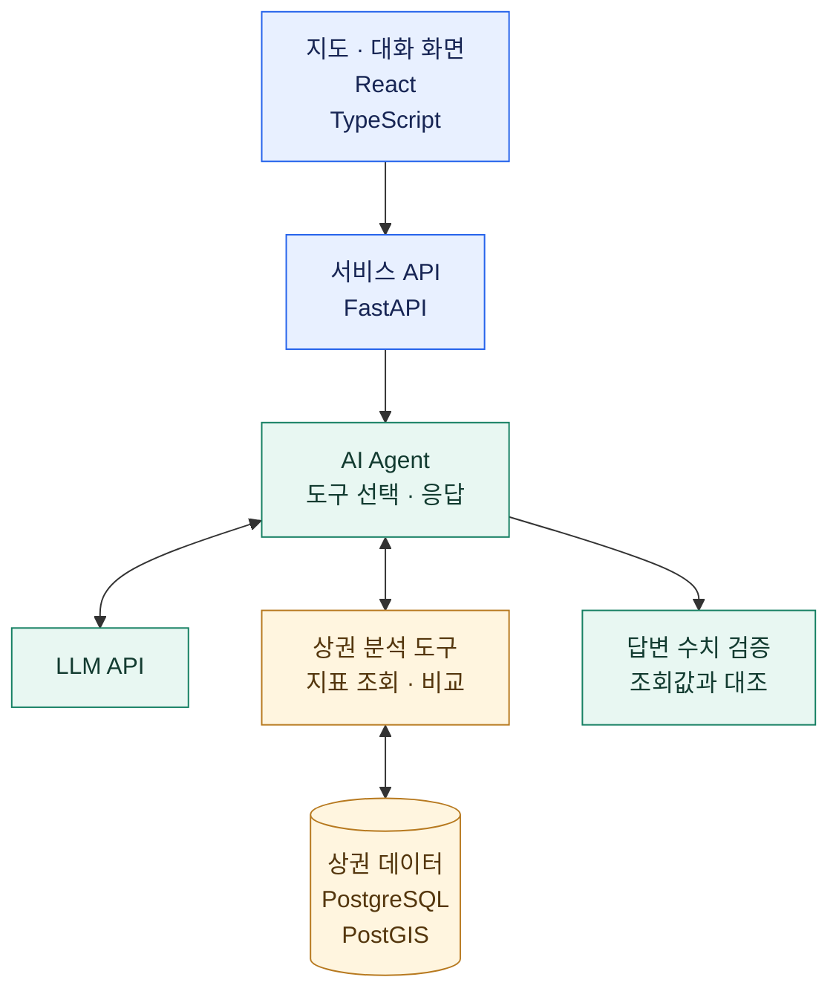
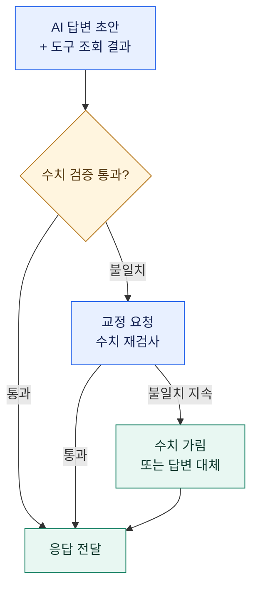

# 김선준 | Sunjun Kim

**AI Agent·LLM 응용 엔지니어**

데이터를 찾고 도구를 실행하는 AI 서비스를 개발함. 추천 시스템 연구를 시작으로 검색·추천, LLM 응용, 품질 평가와 업무 자동화를 맡아 왔음.

[회사 프로젝트](#회사-프로젝트) · [개인 프로젝트](#개인-프로젝트) · [집필·연구](#집필연구) · [이메일](mailto:cyon13022@gmail.com)

## 회사 프로젝트

| 프로젝트 · 회사 | 담당·구현 내용 |
| --- | --- |
| **AI 소프트웨어 유지보수 플랫폼** 위시켓 | 시스템 설계, AI 코드 수정·검증 기능 구현, 작업 근거 관리. 개발 중임. |
| **프로젝트 업무 처리 AI 에이전트** Plantynet | 자연어 요청에 따른 도구 실행, 업무 근거 검색, 실패 후 재시도 로직 설계·구현·배포. |
| **뉴스 요약 품질 자동 평가** Plantynet | 평가 기준 설계, 자동 평가·결과 저장·정기 보고 구현. |
| **매거진 검색·추천 AI 챗봇** Plantynet | 검색·데이터 정리·AI 처리 로직 담당. 의미·키워드 검색과 응답 안전성 검사 구현. |
| **뉴스 요약·분류·태깅 API** Plantynet | LLM 처리 로직·서빙 API 설계·개발·배포. 자체 모델로 요약·분류·태그 추출 기능 제공. |
| **스미싱 URL 탐지** Plantynet | URL 분류 모델 학습, 웹페이지 특징 분석, 성능 확인 기능 개발. |
| **여행 추천·일정 생성 챗봇** AIO2O | AI 파트 리드. 관광지 추천 로직·검색용 데이터 저장소·일정 생성 챗봇 개발. |
| **영화 추천 API** AIO2O | 추천 로직·데이터 저장소 설계. 조건 필터와 의미 검색을 결합한 추천 API 개발. |

아래 도식은 각 프로젝트에서 담당한 기능의 흐름을 단순화한 개념도임.

<strong>AI 소프트웨어 유지보수 플랫폼 · 위시켓</strong>

소프트웨어를 인수·수정할 때 흩어진 코드와 문서를 다시 확인해야 했고, AI가 수정한 코드도 참고 자료와 검사 결과를 함께 검토할 필요가 있었음.

시스템 설계와 핵심 기능 구현, 검증 기준·근거 관리를 담당함. 인수 자료 정리와 코드·문서 검색, AI 코드 수정·검증, 데이터 관계 분석과 작업 상태 확인 기능을 설계·개발하고 있음. 구성요소별 구현·검증을 진행 중이며 전체 운영 연동 검증은 남아 있음.

Rust · Python · TypeScript · PostgreSQL · Docker

<strong>프로젝트 업무 처리 AI 에이전트 · Plantynet</strong>

자연어 업무 요청을 실제 작업으로 연결하고, 흩어진 업무 기록에서 필요한 근거를 찾는 기능을 개발함. 도구 실행이 실패했을 때 원인을 남기고 다음 작업에 활용하도록 구성함.

AI 처리 로직의 설계·구현·배포를 담당함. 업무 도구 실행과 문서 검색을 연결하고, 명세 초안 작성·업무 요약·변경 이력 추적 기능을 구현함. 실행 결과에 따른 재시도와 반복 실패 시 중단 처리도 개발함.

Python · LangGraph · FastAPI · LightRAG · Docker Compose

<strong>뉴스 요약 품질 자동 평가 · Plantynet — 평가·저장·보고 흐름</strong>

뉴스 요약을 일관된 기준으로 검사하고 결과를 정기적으로 확인할 수 있도록 자동 평가 기능을 개발함.

평가 기준 설계, 자동 처리, 데이터 저장과 정기 실행을 담당함. 요약과 원문을 비교해 품질 점수와 판단 이유를 남기고, 처리한 결과의 재사용·실패 작업 재시도·중복 실행 방지를 구현함. 평가 결과를 저장하고 보고서로 정리하도록 구성함.

Python · deepeval/GEval · PostgreSQL · openpyxl

<strong>여행 추천·일정 생성 챗봇 · AIO2O — 검색·추천 설계</strong>

지역이나 여행 일수뿐 아니라 동반자·분위기처럼 말로 표현한 여행 의도를 추천에 반영하는 챗봇을 개발함.

AI 파트 리드로 추천 로직, 검색용 데이터 저장소와 챗봇 개발을 담당함. 관광지 설명과 리뷰를 검색에 활용하고, 여행 조건으로 후보를 좁힌 뒤 요청의 의미를 반영해 추천 순위를 정하도록 구현함. 추천 결과를 여행 일정으로 연결하고 API와 검색용 데이터 저장소를 배포함.

Python · Embedding Models · Vector DB · Docker Compose

## 개인 프로젝트

**MarketScope AI · 지도 기반 상권 분석**

흩어진 상권 통계를 지도와 대화에서 함께 살펴볼 수 있도록 만든 서비스임. 기획·데이터 처리부터 서버·화면·AI 기능까지 1인 개발함.

- 서울시 1,650개 상권 데이터를 연결해 유동인구·매출·업종 정보를 조회하고 상권을 비교하도록 구현함.
- 지도에서 선택한 상권과 대화 내용을 연결하고, AI가 필요한 분석 도구를 호출하도록 개발함.
- AI 답변에 포함된 수치를 도구가 조회한 결과와 대조하는 검증 기능을 구현함.

Python · FastAPI · TypeScript · React · PostgreSQL/PostGIS

공개 저장소에 수록된 화면 예시임.

**시스템 구성**

공개 저장소의 화면·서버·AI 처리 경로를 요약함.

<strong>답변 수치를 확인하는 과정</strong>

설정한 허용 오차 안에서 AI 답변의 수치를 도구 조회값과 대조함. 불일치가 남으면 해당 수치를 가리거나 조회 결과에 근거한 응답으로 대체함. 아래는 수치 검증 경로이며 데이터가 없을 때의 응답 등은 생략함.

[코드·프로젝트 설명](https://github.com/SJayKim/Catchment-Area-Analysis) · [실행 안내](https://github.com/SJayKim/Catchment-Area-Analysis/blob/main/docs/ops/quickstart.md) · [수치 검증 코드](https://github.com/SJayKim/Catchment-Area-Analysis/blob/main/server/server/agent/loop/trust.py)

## 집필·연구

**[Just Read. Agentic AI](https://wikidocs.net/book/19070)**

AI가 도구를 사용하고 계획을 세우며 답변을 점검하는 원리를 논문과 함께 설명하는 책을 공동 집필함. ReAct, Reflexion, GraphRAG 등 에이전트의 주요 방법을 다룸.

**[Agentic AI 논문 노트](https://github.com/SJayKim/agentic_ai_papers)**

에이전트의 기억, 도구 사용, 계획, 자기교정, 검색 관련 논문을 주제별로 정리함. 책과 별도로 개별 논문의 핵심 방법을 찾아볼 수 있는 공개 기록임.

UNIST 산업공학과 석사, 2023. 사용자 선호를 학습하는 추천 시스템을 연구함.

## 사용 기술

| 분야 | 기술 |
| --- | --- |
| AI Agent·검색·평가 | LangGraph, LightRAG, vLLM, Milvus, pgvector, deepeval/GEval |
| 서버·데이터 | Python, Rust, FastAPI, PostgreSQL/PostGIS |
| 화면·실행 환경 | TypeScript, React, Docker |
