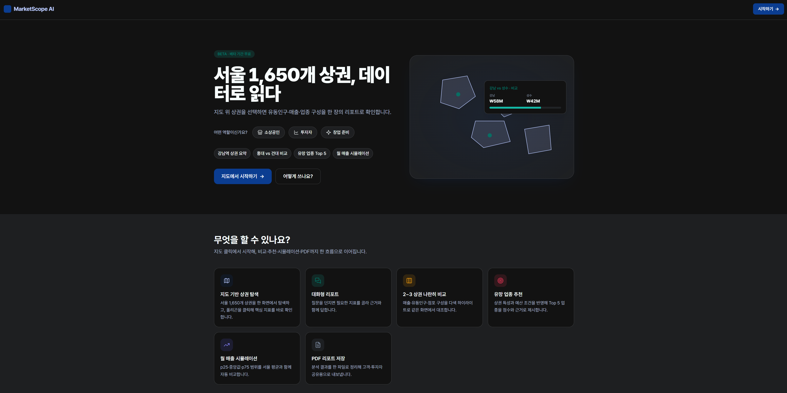

# 기존 프로젝트 상세

기존 공개 포트폴리오의 8개 프로젝트를 문제·역할·실행·결과 중심으로 정리했다. 과거 성과 수치는 2026-09-04 공개 기록에 근거하며 이번 문서 작업에서 모델 평가나 운영 시험을 다시 실행한 값은 아니다. 기간이 없는 프로젝트에는 임의의 날짜를 넣지 않았다.

## 뉴스 요약 품질 자동 평가 시스템

Plantynet · 2026.01~2026.07 · 2명 팀에서 평가 메트릭 설계, 파이프라인 구현, PostgreSQL 적재, 정기 실행 담당.

문제: 약 60만 건 규모의 요약 결과를 수동으로 확인하기 어려웠고, 내용·날짜·허위 정보·문체·형식을 각각 LLM으로 평가하면 호출 수가 커졌다.

실행: 정상 응답률과 길이 비율은 코드로 계산하고, 품질 기준 5개는 한국어 `GEvalTemplate`에 묶어 건당 한 번의 품질 평가 요청에서 점수와 사유를 받도록 설계했다. 발행일을 넣어 상대 날짜의 변환을 평가하고, 이미 적재한 결과를 제외하는 증분 처리와 rate limit 재시도, `cron`·`flock` 중복 실행 방지를 구현했다. 결과를 PostgreSQL·Excel에 적재하고 일일 보고서로 연결했다.

결과: 약 60만 건 규모를 다루는 평가·적재·보고 파이프라인을 구축했다. 기준별 5회 평가 요청을 1회로 통합했다. 호출 수 감소를 토큰 비용의 동일 비율 절감이나 평가 품질 동등성의 실측으로 바꾸어 표현하지 않는다.

기술: Python, deepeval/GEval, OpenAI API, PostgreSQL, openpyxl, cron, flock.

## 스미싱 URL 탐지 시스템

Plantynet · AI 분류 모델, 동적 URL 분석, 파이프라인·모니터링 구축 담당.

문제: 외부 URL 스캐닝 API의 실패와 단축 URL의 정보 부족 때문에 기존 Random Forest 분류에 한계가 있었다.

실행: URL 텍스트를 직접 읽는 URLBert를 사내 데이터로 파인튜닝했다. 리다이렉트 이후 랜딩 페이지를 분석하는 별도 경로에는 한국형 특성 2개를 포함한 HTML 피처 17개를 구성했다. ETL→평가→보고 파이프라인과 성능 추이 확인 기능을 연결했다.

결과: 같은 1:1 균형 평가 조건에서 F1을 58.02%에서 96.10%로 개선했다. URLBert Zero-shot F1은 46.10%였다. 9:1 불균형 조건의 기존 모델 F1 28.79%는 별도 평가이므로 96.10%의 직접 비교 기준으로 사용하지 않는다.

| 모델 | 평가 조건 | Precision | Recall | F1 |
| --- | --- | --- | --- | --- |
| Random Forest | 1:1 균형 | 51.18% | 66.96% | 58.02% |
| URLBert Zero-shot | 1:1 균형 | 65.19% | 35.66% | 46.10% |
| URLBert Fine-tuned | 1:1 균형 | 97.60% | 94.65% | 96.10% |

기술: Python, BERT/URLBert, Hugging Face Transformers, HTML 피처 분석, ETL, 모니터링.

## 프로젝트 업무 처리 AI 에이전트

Plantynet · 3명 팀에서 AI Agent 로직 설계·구현·배포 담당.

문제: 자연어 업무 요청을 실행하는 과정에서 도구 호출 실패가 반복되고, 요구사항과 변경 이력이 흩어졌다.

실행: LangGraph에 Actor→Tool Executor→Evaluator→Reflection 흐름을 구성했다. 프로젝트·업무·활동에 대한 17개 도구를 연결하고 실패 원인과 해결 방법을 LessonsStore에 남겼다. 같은 실패의 반복에는 조기 종료를 적용했다. 업무 문서·첨부파일은 텍스트 정규화와 구조화 요약 후 LightRAG에 색인하고, local·global·hybrid 검색 도구로 제공했다.

결과: 명세 초안 생성, 업무 요약, 변경 이력 추적, 의미 기반 근거 검색을 업무 플랫폼에 연결했다. 실패 후 재시도와 교훈 재사용을 구현했다. 기존에 적힌 재시도 감소율은 평가 모집단과 원자료가 함께 제시되지 않아 요약 이력서에서는 제외했다.

기술: Python, LangGraph, FastAPI, LightRAG, Gemini API, SSE, Docker Compose. 관측 설계에는 Langfuse, Sentry, Grafana를 선정했다.

## 매거진 검색·추천 AI 챗봇

Plantynet · AI 파트 2명 중 검색 엔진·전처리·에이전트 담당.

문제: 매거진 플랫폼의 키워드 검색은 자연어로 표현한 독서 의도에 대응하기 어려웠고 생성 응답의 안전성 검사도 필요했다.

실행: BGE-M3 Dense와 BM25 Sparse 검색을 결합하고 BGE-Reranker로 재정렬했다. 검색 청크의 앞뒤 문맥을 붙였으며 매거진 단위 추천에는 Group Search를 사용했다. 약 15만 청크를 검사해 짧은 텍스트·특수문자·토큰 검증 실패 등 약 1.8만 청크를 걸러냈다. 입력·출력에 LlamaGuard 검사를 적용하고 SSE 응답과 대화 이력 저장을 구성했다.

결과: 의미 검색, 문맥 보강, 응답 안전성 검사를 하나의 챗봇 흐름에 구현했다. 노이즈 제외 비율은 약 12%다. 기존 Recall 개선율은 평가 집합과 상대 개선·%p 구분이 명확하지 않아 제출용 요약에서 제외했다.

기술: Python, LangGraph, FastAPI, Milvus, BGE-M3, BM25, BGE-Reranker, LlamaGuard, Streamlit, Docker Compose.

## 뉴스 요약·분류·태깅 API

Plantynet · 3명 팀에서 LLM 처리 로직과 서빙 API 설계·개발·배포 담당.

문제: 기사 요약·분류·태깅을 외부 API에 의존하면서 호출 비용과 지연이 발생했다.

실행: FastAPI 프로세스 안에서 vLLM 엔진을 실행하도록 구성하고 연속 배칭과 동시 실행 제한을 적용했다. 요약 길이 조정, 긴 문서 축약, 분류·태그 추출을 제공했으며, 조건 분기와 재시도가 필요한 처리에는 LangGraph를 도입했다. v0·v1 인터페이스와 Gradio 검토 화면, GPU 컨테이너 배포를 구성했다.

결과: 해당 텍스트 처리 작업을 자체 모델 서빙으로 전환했다. 외부 API 호출 비용 제거를 전체 인프라 비용 100% 절감으로 표현하지 않는다. 기존 응답 시간 개선율은 비교 모델·부하·하드웨어 조건이 함께 확인되지 않아 요약에서 제외했다.

기술: Python, FastAPI, vLLM, LangGraph, PyTorch, Gradio, Docker, NVIDIA Container Toolkit.

## 부산 여행 추천·일정 생성 챗봇

AIO2O · 부산관광공사 Visit Busan · 2024.01~2024.10 · 5명 팀에서 AI 파트 리드, 벡터 DB·추천 알고리즘·챗봇 개발 담당.

문제: 정해진 코스와 지역·숙박일수 필터만으로는 동반자나 분위기를 표현한 자연어 요청에 대응하기 어려웠다.

실행: 관광지 설명·리뷰의 키워드와 해시태그를 임베딩에 반영했다. 지역·일수·카테고리로 후보를 줄인 후 벡터 유사도로 순위를 매기고 추천 결과로 여행 일정을 구성했다. API와 벡터 DB는 Docker Compose로 배포했다.

결과: 자연어 여행 요청을 추천과 일정 구성으로 연결했다. 기존 공개 기록에는 Visit Busan 상용 서비스 적용 이력이 있다. 현재 서비스의 이용량·가동 여부는 이번 작업에서 검증하지 않았다.

기술: Python, Embedding Models, Vector DB, NLP, Docker Compose.

서비스: [Visit Busan](https://www.visitbusan.net/index.do?menuCd=DOM_000000203018000000).

## 영화 추천 API

AIO2O · Skylife · 2023.06~2023.12 · 4명 팀에서 벡터 DB 설계·추천 알고리즘 담당.

문제: 장르·배우 필터만으로는 비슷한 추천 결과가 반복됐다.

실행: 영화 설명, 감독, 배우, 장르를 임베딩하고 PostgreSQL·pgvector에 저장했다. 메타데이터 필터링으로 후보를 좁힌 뒤 영화 설명의 벡터 유사도로 순위를 정하는 추천 API를 개발했다.

결과: 명시적 선호 조건과 콘텐츠 의미를 함께 반영하는 추천을 구현했다. 클릭률·전환율 등 사업 지표는 별도로 제시하지 않는다.

기술: Python, PostgreSQL, pgvector, Embedding Models, Docker.

## 지도 기반 상권 분석 AI 서비스

서비스명: MarketScope AI. 개인 프로젝트 · 2026.01 시작 · 기획·설계·프론트엔드·백엔드·AI Agent·인프라의 1인 개발. 상태와 수치는 2026-09 공개 기록 기준이다.

문제: 상권 통계가 여러 자료에 흩어져 있고 사용자가 지도와 수치, 분석 결과를 따로 해석해야 했다.

당시 구현 기록: 서울시 1,650개 상권 자료를 적재하고 지도와 챗봇을 연결했다. LangGraph의 Planner·Actor·Evaluator가 11종 도구를 선택·조합하며 의존 관계가 없는 실행을 병렬 처리한다. 지도 선택과 응답을 동기화하고 SSE 이벤트와 리포트 카드로 결과를 표시했다. 실데이터 ETL, 실패·빈 결과 시 추측 방지, 대화 맥락을 반영한 질의 재작성, Langfuse 피드백 연결을 구현했다.

결과: 지도 기반 상권 분석 서비스 v0.4.0 공개 이력이 있다. 당시 Playwright Chromium 66/66 및 production smoke 28/28 통과 기록을 보유한다. 이는 과거 기록이며 현재 재실행 결과가 아니다. OAuth2·결제·Tier 게이팅은 당시 후속 계획으로, 유료 고객이나 매출 실적으로 표현하지 않는다.

기술: Python, FastAPI, LangGraph, PostgreSQL/PostGIS, SQLAlchemy, React, TypeScript, Zustand, SSE, Playwright, Langfuse.

현재 공개 코드와의 구분: 2026-11-23 확인한 [`78aeb1b`](https://github.com/SJayKim/Catchment-Area-Analysis/tree/78aeb1b759e599ce6cc70f9b6697bb1cb1b9939c)에서는 v2 설정과 실제 모델 사용 시 자체 Agentic Loop를 실행하며, Mock 또는 PAE 설정에서는 레거시 LangGraph 경로를 사용한다. v2는 도구 반환값·계산값을 근거로 최종 답변 본문의 수치를 검증한다. 진행 이벤트와 결과 카드는 본문 검증 전에 전송될 수 있다. [현재 구성도](https://sjaykim.github.io/SJayKim/docs/diagrams/marketscope-ai.html)는 이 코드 판을 기준으로 하며, 위의 과거 시험 결과를 현재 재실행 결과로 해석하지 않는다.

서비스: [MarketScope AI](https://marketscope.robitlabs.co.kr).

[경력기술서](../career-history.ko.md) · [포트폴리오](../../README.md)
