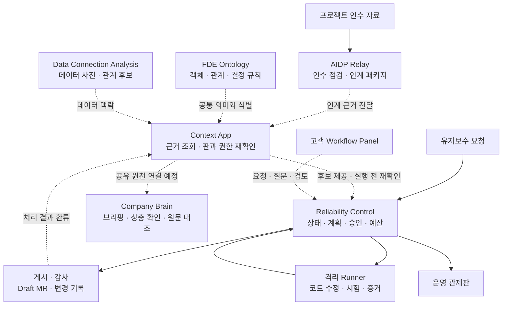

# Project Reliability 및 연계 시스템

Project Reliability는 고객 프로젝트의 유지보수 요청을 접수하고, 필요한 맥락을 확인한 뒤 AI 에이전트가 코드를 수정·시험하도록 제어하는 시스템이다. 인수 자료를 준비하는 AIDP Relay, 근거를 제공하는 Context App, 업무 개념을 정의하는 FDE Ontology, 데이터 구조를 분석하는 DCA, 검토용 Company Brain까지 함께 설계·개발하고 있다.

활동 기준: 2026.11 진행 중. 기여 범위는 시스템 설계, AI 코딩 에이전트를 활용한 구현 진행, 검증 기준과 근거 관리다. 각 구성요소는 서로 다른 구현·검증 단계에 있으며 전체 운영 연동은 아직 완료되지 않았다.

## 해결하는 문제와 접근

유지보수 담당자가 바뀌면 코드, 요구사항, 결정 기록, 실행 환경을 다시 조사해야 한다. AI 에이전트도 이 맥락이 부족하면 범위를 잘못 해석하거나 오래된 근거를 사용한다. 코드 수정에 성공하더라도 검증 결과, 승인한 코드 판, 실제 반영 대상이 일치하는지 별도로 확인해야 한다.

인수 단계의 기능·근거·코드·검증 기록을 구조화하고, 실행할 작업의 범위와 근거를 고정하는 흐름을 설계했다. 실제 구현에서는 상태 전이, 실행 권한, 외부 변경 기록, 비용 한도와 실행 결과를 분리해 관리한다. 완료 여부는 소스 작성, 시험 통과, 사람의 수용, 운영 반영 단계별로 판단한다.

## 전체 구성

아래 그림은 시스템의 역할과 연결 목표다. 점선은 구현·계약 채택·통합 검증이 남은 연결을 나타낸다. 개별 구성요소의 구현 상태는 다음 표에 적었다.

## 구성요소별 기여와 상태

| 시스템 | 기여·구현 내용 | 2026-11-21 확인 범위 |
| --- | --- | --- |
| Reliability Control | 요청 분류, 계획·근거 고정, 상태 전이, 역할별 작업과 승인 흐름을 Rust 제어부에 구현 | Rust 구현 존재. 후속 품질 검증 진행 중 |
| 격리 Runner | 고정한 코드 판에서 에이전트 실행, 수정·검증·미리보기·수용 시험을 수행하고 결과 수집 | Rust Runner와 원격 Docker 연동의 개별 검증 기록 있음 |
| LLM Gateway·예산 관리 | 모델 호출 정책, 사용량 기록, 작업별 유한 예산과 호출 결과 관리 | 구현 존재. 운영 비용 절감률은 측정하지 않음 |
| DB·작업 큐·복구 기반 | PostgreSQL·SQLx, 순방향 마이그레이션, Graphile Worker SQL 스키마를 소비하는 Rust 작업 큐 | 구현 존재. 장기 운영 적격성 검증과 구분 |
| 게시·감사·외부 효과 기록 | GitLab 어댑터, Draft MR 게시, 승인 및 외부 변경 결과 추적 | 일부 실제 연동 검증. 자동 merge·배포 완료로 해석하지 않음 |
| 계약·정책·가림 | JSON 계약 검증, 상태 판정, 민감 정보 가림, TypeScript 기준 구현과 의미 비교 | Rust 구현 대체 완료. TS·Node 비교 시험과 일부 보조기 유지 |
| 운영자 CLI·평가 도구 | `relctl`, 시나리오·평가·시험 도구, Mac·Linux 검증 절차 | CLI와 도구 구현 존재. 실제 모델 평가의 전체 이식은 미완료 |
| 운영 관제판 | 작업 상태, 다음 행동, 주의 항목, 토큰·비용을 읽기 전용 화면으로 구성 | 단계 A는 5개 화면·읽기 API와 합성 검증 기록. B/C는 소스 작성 후 검증·통합 전 |
| 고객 Workflow Panel | 업무 흐름·로그인·조회 게이트웨이와 고객 상태·목록·상세 조회 개발, 후속 요청·응답·승인 흐름 설계 | P2 게이트웨이 로컬 구현. P3 조회 소스 작성·실행 검증 유예. P4~P7 요청·응답·승인·배포 기록 미구현 |
| AIDP Relay | 기능→기대 동작→코드·환경→시험→결과를 연결한 인수 양식·검사기·인계 패키지 | 로컬 자동 준비와 검사 구현. 실제 인수는 조건부 상태 |
| Context App | 출처·판·권한을 보존하는 로컬 검색, CLI·MCP, 유지보수 근거 후보 제공과 재확인 | 로컬 구현 및 한정된 기술 범위 수락. 전체 운영 적격성은 미완료 |
| FDE Ontology | 결정·객체·관계·행동을 YAML로 정의하고 조회 경로와 참조 검증 | 21종 결정, 37종 객체, 30종 관계, 17종 행동 정의. 조직 전체 채택과 별개 |
| Data Connection Analysis (DCA) | 오프라인 카탈로그·SQL 정의로 데이터 사전, 키·관계 후보, 사람 검토 목록 생성 | 로컬 시제품과 합성 시험. 실제 고객 DB·자료 정확도 검증 전 |
| Company Brain | 근거 브리핑, 상충·정정·미확인 표시, 원문 대조와 접근 재확인 UI | FastAPI·React 로컬 시제품. 합성 자료만 사용하며 모델·회사 원천 연결 전 |
| Reliability Demo | 업무 흐름·데이터 관계와 요청→계획→검토→승인→배포 흐름을 설명하는 HTML 시연 | 소스 구현. 가상 데이터·처리만 사용하며 현재 브라우저·시나리오 검증 미완료 |
| 시스템 간 통합 계약 | 식별 매핑, 인계, 등록 초안, 맥락 수입, 실행 전 재확인, 결과 환류, 연결 실행 기록 설계 | 7개 연결부의 설계. 일부 합성 수입 검증을 전체 운영 통합으로 확대하지 않음 |

## Reliability 핵심 구현

제어부와 실행부를 분리해 작업의 판단·승인과 코드 실행을 서로 다른 책임으로 배치했다. 제어부는 API, worker, auditor, publisher, gateway 역할을 갖고, Runner는 제한된 작업 환경에서 Codex·Claude CLI를 실행한다. 운영자 CLI는 상태 조회와 명시적인 작업 명령을 제공한다.

Rust 전환에서는 계약의 의미를 유지하는 일이 핵심이었다. JSON 숫자와 문자열 처리 차이를 고려한 계약 계층, 순수 상태기계, 가림 로직을 두고 TypeScript 기준 구현과 비교하는 시험을 유지했다. Rust 구현이 생겼다는 이유로 기존 비교 시험이나 Node·Playwright 보조기를 제거하지 않았다.

작업 큐는 Graphile Worker의 PostgreSQL 스키마와 자체 Rust 소비자를 사용한다. 외부 작업은 요청한 효과와 관측한 결과를 기록하며, GitLab 게시 결과와 승인·수용 상태를 구분한다. 장애 후 재개나 중복 실행을 다룰 때도 이전 실패와 불확실한 결과를 보존한다.

기술: Rust, Tokio, axum, SQLx, PostgreSQL, Docker, TypeScript, Playwright, GitLab, Codex·Claude CLI.

결과: 제어부·Runner·CLI의 Rust 구현 대체를 완료했고, Mac·Linux 관문 및 실제 모델·GitLab·원격 Docker를 사용한 일부 시나리오의 수락 기록을 확보했다. 후속 연속 실행 검증과 자동 반영 기능은 진행 중이다. 전체 품질 검증 완료나 운영 배포 완료를 주장하지 않는다.

## 인수·검색·공통 모델

AIDP Relay에서는 FDE가 넘기는 자료를 일정한 양식으로 받고, 코드·문서의 판과 점검 결과를 인계 패키지에 연결했다. 다음 담당자가 무엇을 확인했고 무엇이 남았는지 읽을 수 있도록 사람의 원문과 생성 요약을 구분했다. 로컬 입력 검사와 context 초안 생성을 구현했으며 실제 고객 인수의 책임 확인은 별도 조건으로 남겼다.

Context App은 Python·SQLite 기반 로컬 CLI와 6개 MCP 도구로 프로젝트 근거를 제공한다. 유지보수 공급자의 `prepare`는 근거 후보를 준비하고 `validate`는 선택한 근거의 현재성을 다시 확인한다. 기록 부재, 접근 불가, 연결 키 부재를 구분하며 근거가 있다고 해서 에이전트에 전달 가능한 것으로 간주하지 않는다. 최근에는 호출 시간 제한과 실패 시 반환 자료 보존을 보강했다.

FDE Ontology는 업무 결정을 시작점으로 객체와 관계를 정의했다. 업무 값은 원천 시스템에 두고 공통 모델은 이름·키·조회 경로·결정 책임을 설명한다. YAML 참조 검사와 30개 검증 질문으로 모델의 연결을 확인하며, 이름이 비슷하다는 이유로 서로 다른 프로젝트를 자동 연결하지 않는다.

기술: Python, SQLite, MCP, YAML, JSON Schema, Git, Bun.

결과: 인수 패키지, 조회·재확인 인터페이스, 공통 모델의 로컬 구현을 확보했다. Context의 한정된 기술 개선은 수락됐지만, 실제 업무 자료의 사용 승인과 대표 업무를 이용한 운영 검증은 남아 있다.

## 데이터 연결과 업무 브리핑

DCA는 허용된 오프라인 카탈로그와 SQL 정의를 읽어 테이블·열·키·관계 후보를 만든다. SQL의 선언·별칭·조인 근거와 이름 규칙을 분석하고, 확실하지 않은 관계는 사람의 검토 목록에 남긴다. 범위 검사, 스키마 판 변경, 입력 격리, 감사 기록과 보존·파기 절차도 구현했다.

합성 자료 기반 macOS ARM64 시험은 Python 3.11·3.12에서 각각 1,132개 통과했고, Linux ARM64는 각각 1,122개 통과·10개 제외 기록이 있다. 이는 해당 소스 판의 개발 검증이다. 실제 고객 데이터에서의 관계 추론 정확도나 Windows·x86_64 지원 검증을 의미하지 않는다.

Company Brain은 근거가 분산된 상황에서 브리핑과 원문을 함께 읽도록 FastAPI·React 화면을 구현했다. 조회 기준 시점과 기록을 알게 된 시점을 나누고, 상충·정정 관계와 복사 계보를 보존한다. 자료가 빠진 경우와 실제 업무가 수행되지 않은 경우를 구분하며, 기술 시험의 통과를 업무 완료로 표현하지 않는다.

기술: Python, SQL 분석, FastAPI, React, TypeScript, JSON Schema, Playwright.

결과: DCA는 로컬 분석 시제품, Company Brain은 합성 자료 기반 브리핑 시제품으로 검증했다. Company Brain의 실제 모델·Context runtime·Reliability 연결과 회사 인증, 영속 저장, AWS 공유 배포는 후속 범위다.

## 사용자 화면과 운영 관측

운영 관제판은 작업의 현재 상태와 다음 행동, 주의 항목, 사용 자원을 읽는 화면이다. 읽기 전용 DB 권한과 응답 계약을 두고 작업 실행 권한과 구분했다. 단계 A에는 5개 화면과 읽기 API를 구현했고 합성 자료에서 47종 시험 및 CLI 값 대조를 수행한 기록이 있다.

고객 Workflow Panel은 업무 흐름·로그인·지도 조회를 제공하는 P2 게이트웨이를 로컬 구현했다. P3에서는 고객 상태와 요청 목록·상세 조회 소스를 작성했으며 실행 검증과 통합 수락은 남아 있다. P4~P7의 요청 접수·질문 응답·승인·배포 기록은 설계 단계로 아직 구현하지 않았다. 관제판 B/C 역시 소스 작성과 통합 수락을 구분한다.

별도 Reliability Demo에는 일반 업무 패널, 제안용 참조 화면과 선택 페이지를 구성했다. HTML·CSS·SVG·JavaScript로 업무 흐름, 수정 요청, 계획 검토, 시험 실패 후 재시도, 최종 승인과 배포를 가상으로 보여준다. 모든 자료·처리·승인·배포는 시뮬레이션이며 실제 에이전트나 저장소에 연결하지 않았다. 소스 구현과 별개로 현재 브라우저·시나리오 검증은 완료 기록이 없다.

결과: 운영자와 고객의 화면·권한·검토 흐름을 각각 구체화했다. 실제 고객 사용성이나 전체 업무 처리 시간의 개선율은 아직 제시하지 않는다.

## 연결 설계와 다음 검증

| 연결부 | 설계 내용 |
| --- | --- |
| 식별 매핑 | 인수 건, 프로젝트·저장소, 유지보수 서비스를 명시적 키로 연결 |
| 인계 전달 | Relay의 인계 근거를 Context 수집 원천으로 전달 |
| 서비스 등록 | 인수 결과로 사람이 검토할 Reliability 등록 초안 생성 |
| 맥락 수입 | Context의 유지보수 후보를 Reliability 맥락 항목으로 전달 |
| 실행 전 재확인 | Run 직전에 근거의 판·권한과 코드 판을 다시 확인 |
| 결과 환류 | Reliability 처리 결과를 Context의 후속 근거로 축적 |
| 연결 실행 기록 | 입력·출력의 판, 연결 순서, 실패·재시도 결과 기록 |

현재 우선순위는 각 시스템의 미완료 검증을 마친 뒤 연결 계약을 채택하고, 합성 통합 시험과 허용된 실제 업무 파일럿을 구분해 수행하는 것이다. AWS 배치안과 자동 merge·배포는 설계·개발 범위이며 이미 운영 중인 서비스로 표기하지 않는다.

[경력기술서](../career-history.ko.md) · [작성 근거와 확인 범위](../editorial-notes.md) · [포트폴리오](../../README.md)
